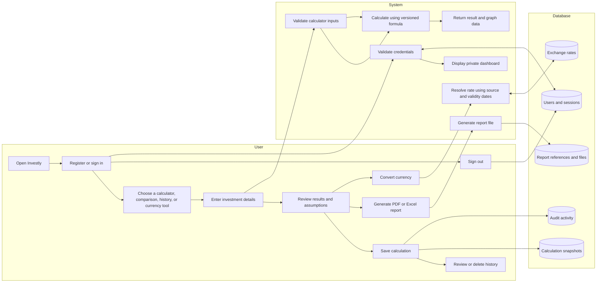
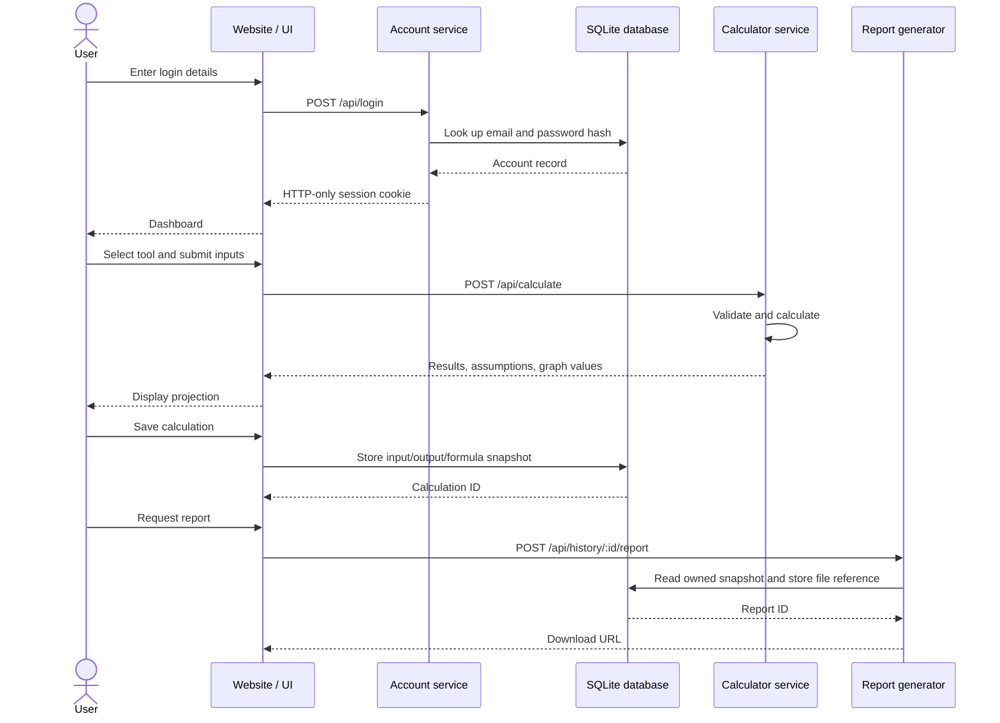
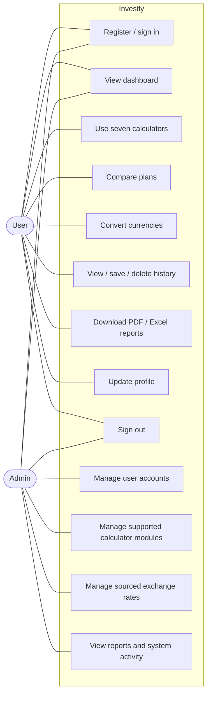
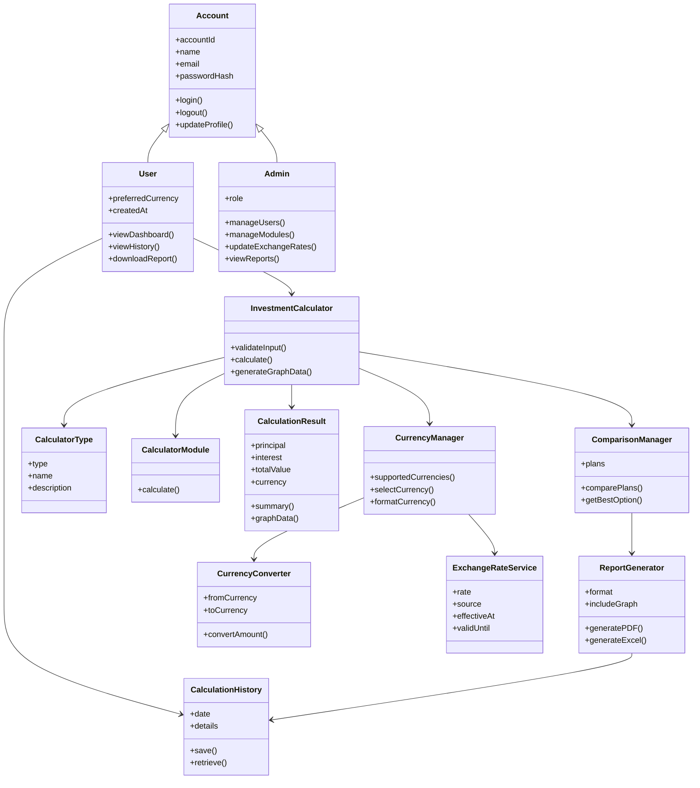

# Investly architecture and diagram mapping

This document records how the supplied diagrams map to the working application. It does not claim to describe object or deployment diagrams; neither was supplied.

## Activity flow: user, system, database

Invalid credentials and invalid calculator input return clear errors; no history snapshot is stored until the user explicitly saves the result. The application uses ownership checks at every history/report read and delete route.

## Sequence diagram: authentication, calculation, report

The logout route invalidates the server-side session and clears the cookie. The report request in this implementation generates a PDF or XLSX file synchronously, then stores the file and reference in one database transaction.

## Use-case diagram: User and Admin

Admin operations are role-protected on the server. The browser only hides the Admin navigation for non-admin accounts; that is not the authorization boundary.

## Domain responsibilities

### Persistence mapping

| UML concept | Implementation |
| --- | --- |
| Account, User, Admin | `users` table (`role` distinguishes user/admin), `sessions` table, scrypt password hashes |
| Calculator Type | `calculator_types` registry; module availability and display metadata are stored here |
| InvestmentCalculator and calculator subclasses | `src/calculators.js` shared validation/formula service and seven typed formula branches |
| CalculationResult and CalculationHistory | `calculations` table stores immutable JSON inputs, outputs, assumptions, formula version, and currency |
| ComparisonManager | `compare()` service and normalized `comparisons` / `comparison_plans` tables |
| CurrencyManager, CurrencyConverter, ExchangeRateService | currency API helpers and `exchange_rates` table with rate source/effective/expiry timestamps |
| ReportGenerator | `src/reports.js`; `reports` stores the generated file, format, graph flag, owner, and calculation reference |
| Admin system activity | `system_activity` audit table |

The module registry is metadata, while the formula engine is a closed set of supported calculators. Admins can change names/descriptions/categories and enable or disable a supported module; they cannot create a new formula engine from the admin UI.
